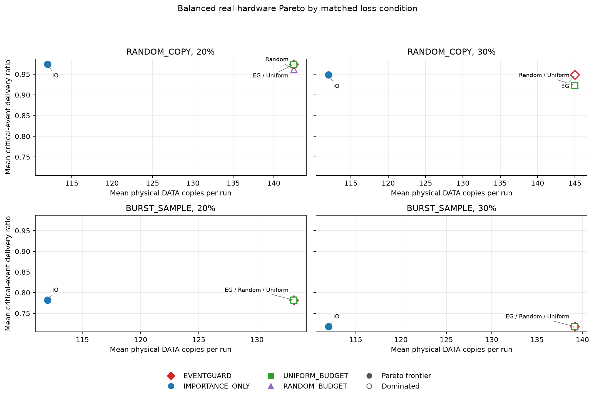

<h1 align="center">EventGuard-LoRa</h1>

<p align="center"><strong>有限通信预算下的关键事件送达研究</strong></p>

<p align="center">事件重要性 · 链路感知冗余 · 等预算评估</p>

---

<p align="center">
  <a href="#project-overview">概览</a> ·
  <a href="#研究问题与方法">方法</a> ·
  <a href="#实现与硬件状态">验证状态</a> ·
  <a href="#relationship-to-smart-agriculture-edge-ai">主项目关联</a> ·
  <a href="README.md">English</a>
</p>

---

<a id="project-overview"></a>

EventGuard-LoRa 研究受限 Sub-GHz 链路上关键事件送达与通信开销的权衡。冻结的 v1 策略结合事件重要性与链路感知冗余，具有主机仿真和两块 ESP32-S3 + E220-400T22D 的实际运行证据。v1 真机证据是 96 个已完成运行的事后平衡分析集；早期 300 次 v0 Pilot 单独归档。

## 研究问题与方法

在精确相同的 DATA 副本预算、同一配对 seed 的相同轨迹和信道日历下，重要性与链路感知冗余能否比等预算策略送达更多关键事件？

事件重要性结合归一化变化、变化率、基线偏差、多通道共变、持续性和方向性风险规则。良好链路下 NORMAL、IMPORTANT、CRITICAL 对应 1、2、3 份副本。链路状态依据**首副本被接受的 ACK 结果**滑动窗口与连续首副本失败，避免不同策略的观测偏差。副本数有上限，物理尝试与 ACK 成败分别计数。详见[冻结算法](docs/algorithm_spec_v1.md)和[配置](configs/default.json)。

```text
Python reference trace ──serial control──> Sensor ESP32-S3 ──E220──> Gateway ESP32-S3
        │                                      ▲                   │
        └── shared run manifest                └────── ACK ────────┘
                       host parser / metrics / plots / report
```

Sensor 分类并发送带 CRC 的紧凑帧，Gateway 校验、对逻辑样本去重、记录副本并回复 ACK。基准轨迹严格使用 10 s 间隔。`REAL_SENSOR_MODE` 是独立演示模式，不是基准结果来源。

## 基线与公平比较

| 策略 | 用途 |
| --- | --- |
| `NO_PROTECTION` / `FIXED_1` | 每样本一份 DATA |
| `FIXED_REDUNDANCY`、`FIXED_2`、`FIXED_3` | 统一副本数；配置的默认冗余为两份 |
| `IMPORTANCE_ONLY` | 仅按重要性选择 1/2/3 份副本 |
| `LINK_ONLY` | 仅按链路状态选择 1/2/3 份副本 |
| `EVENTGUARD` | 重要性与链路状态结合，默认上限三份 |
| `UNIFORM_BUDGET`、`RANDOM_BUDGET` | 轮询或有种子哈希分配，精确匹配 EventGuard 总 DATA 副本数，不读取事件标签或传感器值 |

配对固定模型、丢失率、seed、轨迹与丢失日历；DATA/ACK 日历独立。`RANDOM_COPY` 按键控决策擦除副本机会，`BURST_SAMPLE` 擦除连续样本的全部副本；`BURST_COPY` 是额外的副本级突发模型。真机配置丢失由**接收后的软件丢弃**实现，不是实测 RF 包错误率。

## 主要发现：冻结 v1

### 最终平衡真机分析

四种策略 × 两种模型（`RANDOM_COPY`、`BURST_SAMPLE`）× 两种丢失率（20%、30%）× 六个 seed（31–36），共 **96 次真实设备运行**。每个配对 seed 共享一条 54 样本轨迹。这是原定 160 次 Stage 1 中断后，按执行顺序和完成情况选出的最早连续完整子集，不按结果选取；六个 seed 不是预注册样本量。

| 比较 | 主要发现 |
| --- | --- |
| `IMPORTANCE_ONLY` 与 `EVENTGUARD` | 每个选定配对的关键送达完全相同；EventGuard 每次平均多用 21–33 份 DATA |
| 等预算事件盲基线 | EventGuard 为关键样本分配更高副本比例，但送达收益小且依赖条件 |
| `RANDOM_COPY` 30% | 相对盲基线平均关键送达增加 +0.0256；两个 seed 更高、四个持平 |
| `BURST_SAMPLE` 20% / 30% | 所有策略持平，副本无法恢复被整体擦除的样本 |

`IMPORTANCE_ONLY` 在四个条件均位于观测到的关键送达/开销 Pareto 前沿，EventGuard 均不在前沿。结果不证明增加链路状态机制具有普遍收益。六个配对 seed 只支持方向性描述；描述性 Wilcoxon 与探索性 Holm 校正 p 值不支持确认性显著结论。



离线审计通过 96/96 份日志与 manifest；选定集合无非受控的物理 DATA/ACK 丢失或主机/固件送达差异。后续 `UNIFORM_BUDGET / RANDOM_COPY / 30% / seed37` 的 run103 在 Gateway 注入前日志缺少 DATA 帧后停滞。原因尚未确认，不完整 seed-37 尝试排除于主分析之外，原始证据保留。

详见[硬件报告](results/final_hardware_v1/final_hardware_report.md)、[审计](results/final_hardware_v1/audit_report.md)、[配对检验](results/final_hardware_v1/paired_tests.csv)、[字节开销 Pareto 渲染图](results/final_hardware_v1/plots/pareto_critical_vs_bytes.png)、[论文草稿](docs/paper_draft_final.md)与[研究摘要](docs/final_research_summary.md)。

### 主机仿真

锁定的主机矩阵包含 8,000 次运行（八种策略、五种丢失率、两种模型、100 个评估 seed）。seed 1–30 用于校准，31–130 仅用于评估。C/Python 一致性检查覆盖策略、丢失和预算决策。

简单合成轨迹中，CRITICAL 分类 precision/recall/F1 为 0.8125 / 1.0000 / 0.8966，NORMAL→CRITICAL 假阳性率为 0。`IMPORTANCE_ONLY` 在所有主机配对中以不更多的 DATA 副本匹配 EventGuard 的关键送达；`BURST_SAMPLE` 下副本不改善送达。扩展分析中，EventGuard 位于条件内关键送达/字节 Pareto 前沿的次数为 **0/10**。

报告与保留图表：[验证](results/pre_hardware_validation.md)、[逐运行数据](results/pre_hardware_v1/runs.csv)、[等预算图](results/pre_hardware_v1/plots/critical_delivery_vs_exact_budget.png)、[消融](results/ablation/report.md)、[配对检验](results/ablation/paired_tests.csv)、[Pareto 前沿](results/plots/pareto/pareto_frontier.png)、[敏感性](results/sensitivity/report.md)、[失败案例](results/failure_analysis.md)与[研究状态](results/research_status_report.md)。敏感性范围为关键阈值 2.0–4.0、窗口 8/12/16/24、副本上限 2/3；v1 日历不支持四副本。

## 实现与硬件状态

两块 ESP32-S3/E220-400T22D 使用 ESP-IDF v5.4.4、原生 UART 驱动。Sensor 配置包含 SHT30、BH1750、电容土壤传感器和可选 OLED；Gateway 使用 ESP32-S3/E220。记录的无线配置为 UART1 9600 baud，TX/RX/AUX GPIO 17/16/15，M0/M1 GPIO 13/14，地址 `0x0000`，REG0 `0x62`，信道 `0x17`。固件启动核验配置，不改写模块。

实验实际传输 UART 与无线帧。`estimated_communication_time_ms` 是 UART 时间代理，公式为 `(DATA bytes + ACK bytes) × 10 / 9600` 秒，不是 RF PHY 空口时间。未测量焦耳能耗。run103 接收路径停滞仍是未解决硬件限制。

## 快速开始与复现

主机分析需要 Python 依赖，不需要设备：

```sh
python3 -m venv .venv
source .venv/bin/activate
python -m pip install -r requirements.txt
python tools/run_all_experiments.py --simulate
python tools/run_research_analysis.py
```

第二个分析命令增加 11,000 次主机敏感性运行。仅从保留日志重建最终硬件摘要和渲染图，无需连接硬件：

```sh
python tools/finalize_hardware_dataset.py
```

可选检查：`python -m unittest discover -s tests -v`。物理重跑使用 `tools/run_all_experiments.py` 并需要两块板；[运行证据](results/hardware_validation_v2_policy_v2/)和硬件报告记录实验过程。

## Relationship to Smart-Agriculture-Edge-AI

[Smart-Agriculture-Edge-AI](https://github.com/Sver0411/Smart-Agriculture-Edge-AI) 参考 EventGuard-LoRa 的通信策略和实验方法。完整冻结冗余策略未直接集成，本项目保持独立链路策略研究定位。

## 局限与后续工作

一个设备对、短合成轨迹、软件注入擦除和每条件六个真机 seed 限制泛化。受控 RF 衰落/干扰、距离、物理信道错误率、能耗、法规空口占用和田间分类尚未评估。后续优先进行真实 RF 实验；四副本需要新策略/日历，v0 Pilot 不能与 v1 合并。

## Pilot 归档：v0 E220

<details>
<summary>展开独立的 300 次 Pilot 及保留的渲染图链接</summary>

原始 Pilot 使用三种策略、五种配置丢失率、两种丢失模型、十个 seed，以及含重复时间戳的旧 18 样本轨迹（8 NORMAL、6 IMPORTANT、4 CRITICAL），不能验证冻结 v1。

| 策略 | 平均关键送达 | 平均整体送达 | 平均字节/运行 | 平均延迟（ms） |
|---|---:|---:|---:|---:|
| 无保护 | 0.800 | 0.837 | 664 | 415 |
| 固定冗余（2 份） | 0.927 | 0.929 | 1,340 | 492 |
| EventGuard（最多 3 份） | 0.968 | 0.945 | 1,579 | 544 |

EventGuard 平均关键送达最高，比固定冗余多约 17.8% 字节。历史“相近开销”比较可能混合丢失率，不是等预算证据。软件注入丢失与 RF 错误率分开。Pilot 固件使用 16,383/16,384 字节可用 IRAM，余量紧张。

原始记录：[报告](results/report.md)、[CSV](results/summary.csv)、[JSON](results/summary.json)、[固件尺寸](results/firmware_size.json)和[论文提纲](docs/paper_outline.md)。原渲染图链接保留：[关键送达](results/plots/critical_delivery_vs_loss.png)、[整体送达](results/plots/overall_delivery_vs_loss.png)、[送达与字节](results/plots/critical_delivery_vs_overhead.png)和[延迟](results/plots/latency_vs_strategy.png)。

</details>

## 使用与权利

本仓库公开供研究审阅、作品展示、复现检查和学术引用。

本项目**未以开源许可证发布**。

Copyright © 2026 Sver0411. All rights reserved.

对实质性项目代码、固件、数据集、图表或文档进行复用、修改、再分发、再发布或商业使用，须事先获得作者许可。

详见 [NOTICE.md](NOTICE.md)。

## 引用

学术或技术工作引用 EventGuard-LoRa 时，请使用 [`CITATION.cff`](CITATION.cff) 中的元数据。

冻结研究版本为 [`v1.0.0`](https://github.com/Sver0411/EventGuard-LoRa/releases/tag/v1.0.0)。
